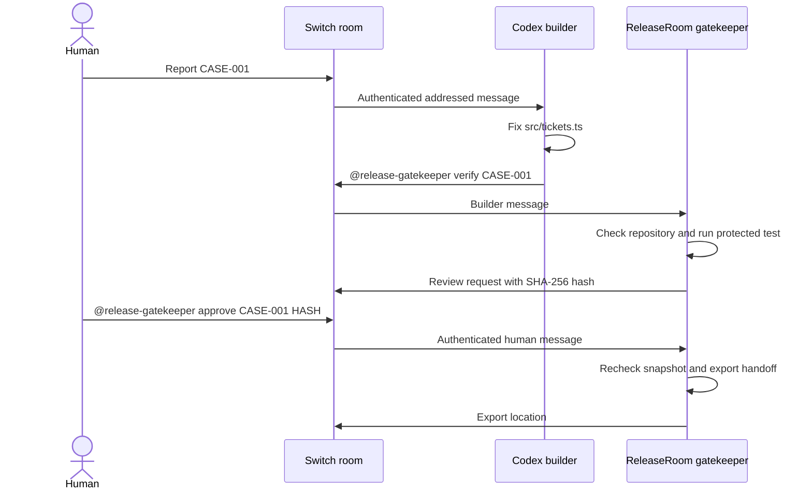

# ReleaseRoom

A bug report, a verified patch, and a human-approved handoff in one Switch room.

[Watch the narrated 110-second walkthrough](https://youtu.be/CgD3kSIa8W0) · [Download the narrated MP4](https://github.com/mosesfawole/releaseroom/releases/download/v0.1.0/releaseroom-demo-narrated.mp4) · [Download the verified handoff](https://github.com/mosesfawole/releaseroom/releases/download/v0.1.0/releaseroom-handoff.zip)

ReleaseRoom gives a Codex builder one small support-ticket bug to fix. A deterministic gatekeeper receives authenticated messages through Switch, runs the protected regression test, hashes the patch and evidence, and waits for the configured human to approve that exact hash. Approval exports a patch and review report.

The gatekeeper uses no model. Switch supplies the room, authenticated sender identities, addressing, and the event stream. Without Switch, the live room workflow cannot run.



## Requirements

- Node.js 24 or newer, npm, and Git.
- For WSL, keep the running demo clone and its `node_modules` on the Linux filesystem. The Windows-mounted drive was substantially slower in the recorded integration checks.
- An official Switch server, agent controller, and connected messaging app. The completed live setup uses the official Console 0.40.1 controller bundle, Switch core 0.31.0, Ubuntu WSL, and Mattermost. The genuine builder, independent verification, user-authorized approval relay, and handoff export are recorded in [evidence](docs/evidence.md). See the [recorded runtime setup](docs/local-runtime.md).
- A configured Codex builder using an existing provider allowance. Switch and the gatekeeper are local software; any model usage is governed by your provider.

## Build and check

From a clone of this repository:

```sh
npm ci
npm test
npm run typecheck
npm run build
npm run verify:case
```

The public source contains the **correct** implementation. `verify:case` prints one JSON result and returns zero when the protected case passes.

## Prepare an isolated demo clone

Use a separate clone for the builder and gatekeeper. Keep development work in your original clone. Replace `/path/to/releaseroom` with your existing clone, and run:

```sh
git clone /path/to/releaseroom releaseroom-demo
cd releaseroom-demo
npm ci
npm run build
npm run demo:reset
git add src/tickets.ts
git -c user.name='ReleaseRoom Demo' -c user.email='demo@example.invalid' commit -m 'demo: seed CASE-001 status filter bug'
npm run verify:case
```

The last command must fail: open tickets are filtered using `!==`. Committing the seeded bug establishes the baseline for a useful `changes.patch` when the builder repairs it. The builder must leave its fix uncommitted; staged and unstaged changes are both reviewed against HEAD.

To restore this disposable demo without an agent, copy `demo/seeded-bug/tickets.ts` only when resetting; for the correct implementation run:

```sh
git show HEAD~1:src/tickets.ts > src/tickets.ts
npm run verify:case
```

Use a UTF-8 shell for redirection (bash or PowerShell 7). This restore command assumes the seeded demo commit is the latest commit.

## Configure Switch

Follow the [official quickstart](https://docs.switchagents.ai/switch-rooms/getting-started) to start a local server and connect Mattermost. Use free ports separate from any existing application. Create `release-builder`, a custom protocol agent named exactly `release-gatekeeper`, and a `release-room` containing both agents and the reviewing human.

Give the builder [these instructions](docs/codex-builder-instructions.md), set its working directory to the demo clone, and attach the [room instructions](docs/room-instructions.md). Register the custom gatekeeper using Switch's supported registration flow. Keep the returned key local.

Copy `.env.example` to `.env` in the demo clone and replace every placeholder. Get the actual API URL from Switch, not from a guessed port. The example port is illustrative. Set `SWITCH_HUMAN_ID` and `SWITCH_BUILDER_ID` to the authenticated `payload.sender` values seen in this room's events; names and display labels are not identity checks. The identities must differ. Keep IDs and credentials out of screenshots and commits.

```sh
npm start
```

The process writes a local `.runtime/journal.json`. Run only one gatekeeper per demo clone. A lock file prevents concurrent processes. After a forced crash, verify that the recorded PID is no longer running before removing `.runtime/gatekeeper.lock`.

## Run the room workflow

1. The human reports that selecting open tickets shows closed tickets and asks `@release-builder` to fix CASE-001.
2. The builder changes only `src/tickets.ts`, leaves the fix uncommitted, and posts `@release-gatekeeper verify CASE-001`.
3. The gatekeeper checks the repository and protected harness, runs the regression test, and posts a review hash. Review the actual diff and test evidence in the local journal.
4. The human personally sends `@release-gatekeeper approve CASE-001 <the exact 64-character hash>`.
5. The gatekeeper rechecks the repository and exports `review.json`, `changes.patch`, and `HANDOFF.md` under `artifacts/CASE-001/<hash>/`.

The command grammar accepts only the known case and lowercase SHA-256 hashes, optionally prefixed by the exact gatekeeper mention. No command contains a shell expression or arbitrary path. The room client delivers only addressed messages in the configured room.

If the patch, HEAD, protected files, or tracked repository state changes, the old approval cannot export. Changes outside `src/tickets.ts` and untracked files are rejected (ignored runtime files are permitted). Repeated approval message IDs and already-exported hashes do not export twice.

A Switch event gap saves a paused state. Inspect the missing room history, stop the gatekeeper, then run `npm start -- --recover-gap`. Recovery clears pending approvals and requires the builder to verify again. Connection failures are visible; failed room deliveries are logged with credential redaction. A restart begins at the stream head, so send a new verification if a command arrived while the process was stopped.

## Scope and evidence

This is a controlled, fictional single-case demonstration. It exports files for review; it does not deploy or merge. It is not an isolation boundary against a malicious process sharing the operator's OS account. See [security](docs/security.md), [demo script](docs/demo-script.md), and [recorded checks](docs/evidence.md).

Built for the Best Business Workflow track of [Flip the Switch](https://www.wemakedevs.org/hackathons/switch). Development uses AI assistance. The entrant completes registration and submission personally under the [official rules](https://www.wemakedevs.org/hackathons/switch/rules).

MIT licensed. Switch and other dependencies retain their own licenses.
