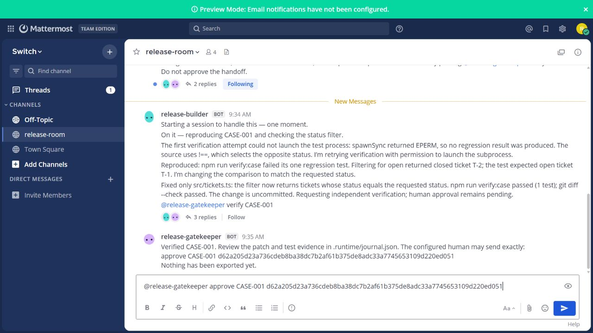
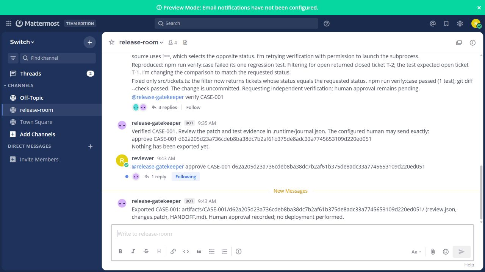

# Verification evidence — 5 November 2026

## Application checks

Verified from a fresh local clone of commit `78b0149` on Windows, using Node.js 24.19.0 and npm 11.17.0:

| Command | Observed result |
| --- | --- |
| `npm ci` | 50 packages installed; audit reported zero vulnerabilities |
| `npm test` | 7 test files, 22 tests passed |
| `npm run typecheck` | Exit 0 |
| `npm run build` | Exit 0 |
| `npm run demo:reset` | CASE-001 reset succeeded |
| `npm run verify:case` after reset | Exit 1; expected T-1 (open), received T-2 (closed) |
| `git restore src/tickets.ts` then `npm run verify:case` | Exit 0; protected regression test passed |
| `git status --short` | Empty after restoration |

The service integration tests use real temporary Git repositories and the actual protected verification harness. They cover configured-builder verification, configured-human approval, export files, replay across restart, staged patch changes, harness edits, failed verification, durable pause after event gaps, and bearer redaction. Protocol tests use a local HTTP/WebSocket server and check authentication, addressing, heartbeat cursor handling, reconnect gaps, and HTTP/network failures. These automated fixtures are not evidence of a live Switch/Codex demonstration.

## Local runtime preparation

Installed and observed inside Ubuntu 26.04 WSL: Node.js 24.19.0, npm 11.17.0, Docker Engine 29.1.3, and Docker Compose 2.40.3. Docker responds as the normal WSL user. No Windows group change was used.

An independent clone on WSL's native filesystem passed all 22 tests in 8.49 seconds, type checking, and build. The first WSL run on the Windows-mounted filesystem passed 21/22 tests but exceeded the demo integration test's 20-second limit (26.57 seconds). The native-filesystem run resolves that runtime concern; use a native Linux directory for the live demo. The demo clone currently resides under `/var/tmp/releaseroom-work/demo`.

The Node archive's SHA-256 matched the [official Node distribution checksum](https://nodejs.org/dist/v24.19.0/SHASUMS256.txt). The intended Console is the [official Switch Console 0.40.1 release](https://github.com/sandbox-quantum/switch/releases/tag/switch-console-v0.40.1), which bundles Switch core 0.31.0.

AgentRouter rejected the existing credential with HTTP 401. The user explicitly authorized using their existing Codex sign-in instead for the live builder demo. This supersedes the earlier AgentRouter-only constraint for that demo. No key or token is included in public evidence.

## Live demonstration

Observed on 5 November 2026 in the official Switch 0.31.0 Compose stack, with Mattermost 11.9.0 and the official controller from Console 0.40.1:

- Switch `/health` returned HTTP 200. Gateway and Mattermost answered successfully.
- The official controller precheck detected Codex 0.166.0 and reported `auth: ok`. The managed `release-builder` was running and attached.
- At 09:34 CET, the reviewer posted the fictional CASE-001 bug report in the real `release-room` Mattermost channel.
- The genuine Codex session initially encountered an EPERM subprocess-launch restriction, disclosed that no test result had been produced, and retried through its normal permission flow. It then reproduced the regression: selecting open tickets returned closed ticket T-2 instead of T-1.
- At 09:35 CET, the builder changed only `src/tickets.ts` from `!==` to `===`, left the fix uncommitted, observed its regression test passing, and posted `@release-gatekeeper verify CASE-001` through Switch.
- The connected gatekeeper independently ran the protected regression test and produced a passing review bundle with hash `d62a205d23a736cdeb8ba38dc7b2af61b375de8adc33a7745653109d220ed051`.

The user explicitly approved that exact hash in Codex with “Approve this hash and relay it.” At 09:43 CET, the assistant transmitted the drafted command from the local Mattermost reviewer account. This is an authorized relay: the evidence does not claim the user physically typed it in Mattermost. The gatekeeper accepted the configured authenticated account, matched the current hash, rechecked the repository, and exported `review.json`, `changes.patch`, and `HANDOFF.md`. The server contained one exact reviewer approval message and one export notification.

The exported canonical bundle hash, patch bytes, and passing test evidence were independently checked. The exported patch then applied to a clean clone of the committed seeded baseline, where `npm ci` and `npm run verify:case` succeeded. The live fixed demo also passed all 22 tests (8.70 seconds), type checking, build, and `git diff --check`. Its only source change remained the expected uncommitted `src/tickets.ts` fix.

The user-facing handoff preserves the three generated files unchanged and adds a separate approval-provenance note. Private journals, credentials, sender IDs, and raw logs are not published.

The WSLg Console capture helper returned an unrelated window image, so setup uses the official Gateway and bundled headless controller instead. [Local runtime notes](local-runtime.md) describe the verified components and ports.

No deployment, users, measured time savings, or production safety claim is made.

## Evidence package

The [v0.1.0 release](https://github.com/mosesfawole/releaseroom/releases/tag/v0.1.0) contains the exported handoff ZIP and a 110-second evidence walkthrough. The narrated edition adds synthetic English speech, synchronized to all five scenes, using a local Microsoft Hazel voice. The video uses actual before-approval and after-export room screenshots, the exact patch, and captions describing the observed checks. It is an illustrated walkthrough, with the user-authorized approval relay disclosed. The original silent edition is retained as a historical asset. The narration script is included in the repository and release.

The narrated edition is also [available on YouTube](https://youtu.be/CgD3kSIa8W0), saved as unlisted at the user's request. YouTube reported the upload published and its copyright check found no issues. The entry form explicitly requires YouTube or Loom hosting, so the YouTube URL is the submission link.

## Event submission

The entrant personally completed the final WeMakeDevs submission. On 5 November 2026 at 10:22 CET, the site displayed SUBMITTED, ReleaseRoom, Solo entry, and Best Business Workflow. The submitted record linked the public repository and the narrated YouTube video. The assistant prepared the fields and verified the resulting confirmation; it did not press the final submission button. A receipt screenshot is retained locally. Exact submitted project fields are saved in `submission-fields.json`.
